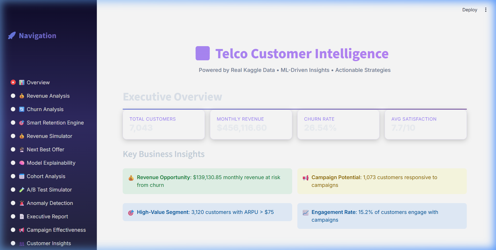
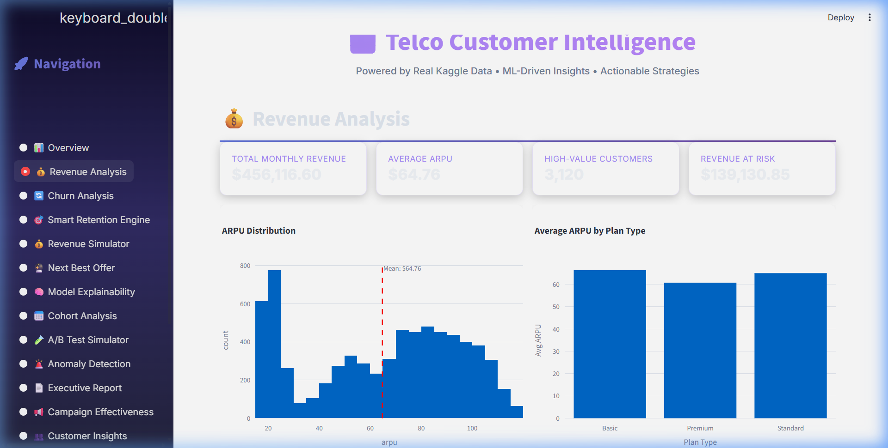

# Telco Customer Intelligence Platform

Portfolio-ready data science project for telecom churn analytics, retention decisioning, next-best-offer recommendation, and executive reporting.

## Dashboard Preview




This project is positioned for a **Data Scientist** resume: it shows business problem framing, feature engineering, predictive modeling, explainability, experimentation, and deployment-ready delivery through a dashboard and API.

## Business Problem

Telecom companies lose recurring revenue when high-value customers churn or remain on poorly matched plans. This project analyzes customer behavior to answer three practical questions:

- Which customers are most likely to churn?
- Why are they at risk?
- What action should the business take next to preserve or grow revenue?

## Data Source

Base dataset:

- IBM Telco Customer Churn dataset (Kaggle), 7,043 customer records

Project enrichment:

- The raw churn dataset is enriched into a multi-table customer 360 schema with derived usage, billing, CRM, engagement, and campaign fields.
- The original Kaggle churn label remains the churn target.
- Derived fields are documented transparently because they are used to demonstrate richer feature engineering and business decision workflows.

## Data Science Workflow

1. **Data ingestion and enrichment**
   - Downloads / loads Kaggle churn data.
   - Cleans `TotalCharges`, hashes customer IDs, and creates normalized customer-domain tables.
   - Builds CSV outputs and a SQLite database for reproducible analysis.

2. **Feature engineering**
   - RFM scores, usage ratios, customer health score, risk indicators, engagement measures, campaign response features, and customer segments.

3. **Predictive modeling**
   - Churn prediction using gradient boosting / LightGBM / XGBoost options.
   - ARPU prediction / forecasting support.
   - Next-best-offer ranking using eligibility logic and conversion propensity modeling.

4. **Explainability and decisioning**
   - SHAP-based global feature importance and customer-level explanations.
   - Churn driver identification.
   - ROI-ranked retention recommendations.

5. **Experimentation and monitoring**
   - A/B test simulator with statistical significance testing and ROI estimates.
   - Anomaly detection across KPIs and customer segments.
   - Cohort analysis for retention and revenue behavior over tenure.

6. **Delivery**
   - Streamlit dashboard for business users.
   - FastAPI service for real-time churn and offer predictions.
   - PDF executive report generation.

## What Is Included

- `generate_data.py`: data pipeline entry point
- `train_model.py`: trains/saves the API-facing churn model and metrics report
- `src/data_loader.py`: Kaggle load + enrichment pipeline
- `src/churn_pipeline.py`: reusable sklearn training + serving pipeline
- `src/preprocessing.py`: feature engineering utilities
- `src/models.py`: churn, ARPU, uplift, and impact modeling classes
- `src/retention_engine.py`: health scoring, churn drivers, retention strategy ROI
- `src/nbo_engine.py`: next-best-offer recommendation logic
- `src/explainability.py`: SHAP explanation workflow
- `src/ab_test_engine.py`: A/B test simulation and significance testing
- `src/anomaly_detector.py`: KPI and segment anomaly detection
- `dashboard/app.py`: Streamlit dashboard
- `api/app.py`: FastAPI prediction API
- `reports/business_report.md`: executive project brief

## Quick Start (Docker)

```bash
docker-compose up --build
```

- Dashboard: `http://localhost:8501`
- API docs: `http://localhost:8000/docs`

## Quick Start (Local)

```bash
python -m venv .venv
.venv\Scripts\activate
pip install -r requirements.txt
python generate_data.py
python train_model.py
uvicorn api.app:app --host 0.0.0.0 --port 8000
streamlit run dashboard/app.py
```

## Project Layout

- `src/`: data enrichment, feature engineering, ML, and analytics engines
- `api/`: FastAPI app for real-time predictions
- `dashboard/`: Streamlit business dashboard
- `data/raw/`: enriched CSV tables and source dataset CSV
- `data/processed/`: generated model/analytics artifacts
- `notebooks/`: exploratory and modeling notebooks
- `reports/`: executive reporting outputs
- `tests/`: smoke tests for loader/model structure

## Resume Positioning

Suggested resume bullet:

> Built an end-to-end telecom customer intelligence platform using Python, scikit-learn, SHAP, Streamlit, and FastAPI to predict churn, explain risk drivers, simulate retention experiments, and recommend ROI-ranked next-best actions from a 7K-customer churn dataset.

Stronger Data Scientist version:

> Developed a churn and retention analytics system on IBM Telco customer data, engineering customer health, usage, payment, engagement, and campaign features; trained gradient boosting models, applied SHAP explainability, and translated predictions into ROI-ranked retention and next-best-offer recommendations.

## Implemented Portfolio Improvements

- Consolidated API-facing churn training into one reusable sklearn pipeline with saved model artifacts.
- Moved API startup from training-on-launch to loading `artifacts/churn_model.joblib`.
- Added PR-AUC, Brier score, threshold metrics, and confusion matrix reporting.
- Added a generated `reports/metrics.md` so model performance is easy to cite after running `python train_model.py`.

## Recommended Next Improvements

- Add model monitoring / drift tracking for the saved churn pipeline.
- Replace simulated NBO labels with a clearly labeled propensity/eligibility framework or a real offer-response dataset.
- Add GitHub Actions for tests and data schema validation.

## Transparency Notes

- The churn label comes from the Kaggle dataset.
- Several customer 360 fields are derived for demonstration and feature engineering depth.
- The NBO engine uses simulated conversion labels where real offer-response labels are unavailable. This is useful for a portfolio demo, but should be described honestly in interviews.
